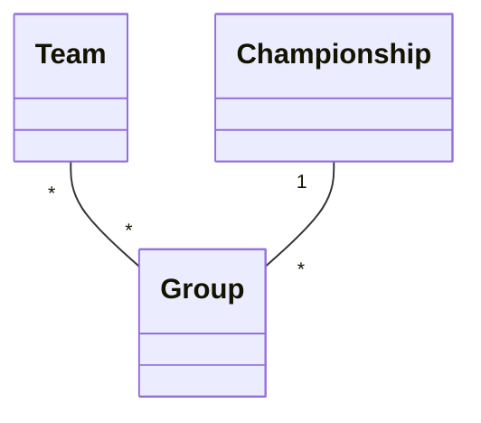
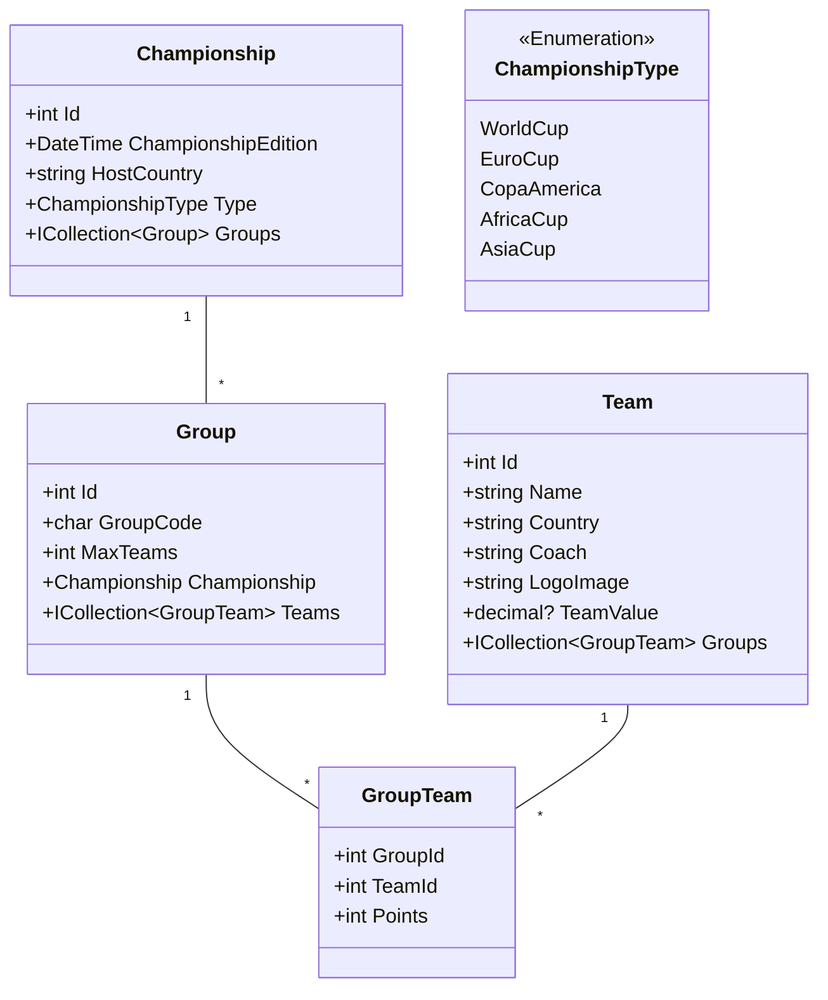

# Tournament Tracker

- Naam: Ebrahim Hdida
- Studentennummer: 0173779-52
- Academiejaar: 25-26
- Klasgroep: INF201A
- Onderwerp: Soccer Championship: Team _ - _ Group \* - 1 Championship

## Sprint 1



## Sprint 3

### Beide zoekcriteria ingevuld

```sql
SELECT "g"."Id", "g"."ChampionshipId", "g"."GroupCode", "g"."MaxTeams"
FROM "Groups" AS "g"
WHERE "g"."GroupCode" = @__code_Value_0 AND "g"."MaxTeams" = @__maxTeams_Value_1
```

### Enkel zoeken op GroupCode

```sql
SELECT "g"."Id", "g"."ChampionshipId", "g"."GroupCode", "g"."MaxTeams"
FROM "Groups" AS "g"
WHERE "g"."GroupCode" = @__code_Value_0
```

### Enkel zoeken op MaxTeams

```sql
SELECT "g"."Id", "g"."ChampionshipId", "g"."GroupCode", "g"."MaxTeams"
FROM "Groups" AS "g"
WHERE "g"."MaxTeams" = @__maxTeams_Value_0
```

### Beide zoekcriteria leeg

```sql
SELECT "g"."Id", "g"."ChampionshipId", "g"."GroupCode", "g"."MaxTeams"
FROM "Groups" AS "g"
```

## Sprint 4



## Sprint 6

### Nieuwe Championship

#### Request

```http
POST http://localhost:5199/api/championships
Content-Type: application/json
Accept: application/json

{
  "championshipEdition": "2025-10-01T00:00:00Z",
  "hostCountry": "USA",
  "type": 3
}
```

#### Response

```http
HTTP/1.1 201 Created
Content-Type: application/json; charset=utf-8
Date: Tue, 18 Aug 2026 08:04:23 GMT
Server: Kestrel
Location: http://localhost:5199/api/championships/5
Transfer-Encoding: chunked

{
  "id": 5,
  "championshipEdition": "2025-10-01T00:00:00Z",
  "hostCountry": "USA",
  "type": "AfricaCup",
  "groupCount": 0
}
```
