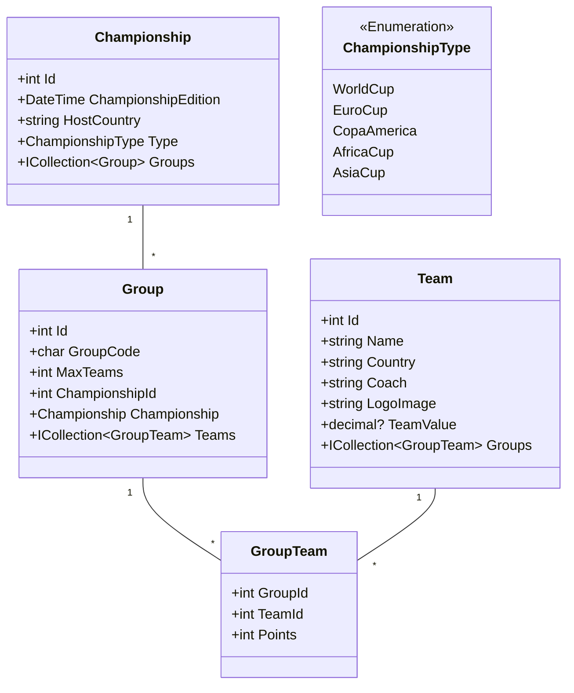
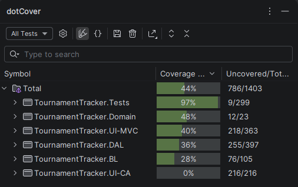

# ebrahim.hdida-project

# Sprint 4 - Project .NET Framework

- Naam: Ebrahim Hdida
- Studentennummer: 0173779-52
- Academiejaar: 25-26
- Klasgroep: INF201A
- Onderwerp: Soccer Championship: Team * - * Group * - 1 Championship



## Sprint 7

### Users

| Email | Password | Role |
|---|---|---|
| lars@kdg.be | Password1! | user |
| ebrahim@kdg.be | Password1! | user |
| ayoub@kdg.be | Password1! | user |
| ali@kdg.be | Password1! | admin |
| chris@kdg.be | Password1! | admin |

### First API request

```http
# @no-cookie-jar
# @no-redirect
POST http://localhost:5199/api/championships
Content-Type: application/json
Accept: application/json

{
  "championshipEdition": "2030-01-01T00:00:00",
  "hostCountry": "Testland",
  "type": 0
}
```

### First API response

```http
HTTP/1.1 401 Unauthorized
Content-Length: 0
```

### Second API request

```http
# @no-cookie-jar
# @no-redirect
POST http://localhost:5199/api/championships
Content-Type: application/json
Accept: application/json
Cookie: .AspNetCore.Identity.Application=PASTE_AUTH_COOKIE_HERE

{
  "championshipEdition": "2030-01-01T00:00:00",
  "hostCountry": "Testland",
  "type": 0
}
```

### Second API response

```http
HTTP/1.1 201 Created
```

## Sprint 8

### Test command

```shell
dotnet test
```

###  coverage



### Test klassen

-  authorizatie : `TeamsApiController`
- Verificatie: `TournamentTracker.Tests.UnitTests.ManagerTests`

### GitLab images

- [GitLab](https://gitlab.com/kdg-ti/programmeren-2-dotnet/25-26/inf201/projects/ebrahim.hdida/-/pipelines/2401428694)

