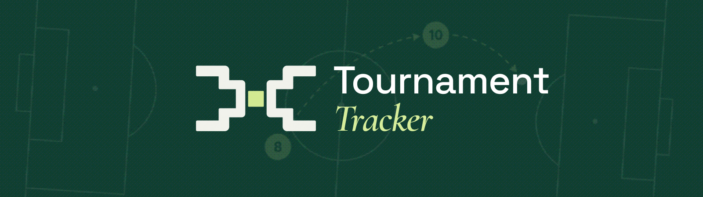

<div align="center">




# Tournament Tracker

**A learning project built to practise clean N-layer architecture and ASP.NET Core MVC.**

Manage football teams, groups, and championships while exploring separation of concerns, dependency injection, data access, and authentication.

<p>
  
  
  
  
</p>

[Features](#features) · [Architecture](#architecture) · [Getting Started](#getting-started)

</div>

## Features

| | |
|---|---|
| **Tournament browsing** | Explore championships, groups, teams, coaches, and squad values. |
| **Team management** | Add teams and manage group membership. |
| **Authentication** | Register and sign in with ASP.NET Core Identity. |
| **Authorization** | Protect changes with roles and team ownership checks. |

## Architecture

The focus is learning to keep presentation, business logic, and persistence separate, using shared domain models and interface-based services.

| Project | Responsibility |
|---|---|
| `TournamentTracker.Domain` | Entities, relationships, and domain validation |
| `TournamentTracker.BL` | Business logic and the manager interface |
| `TournamentTracker.DAL` | Repositories, EF Core, SQLite, and seed data |
| `TournamentTracker.UI-MVC` | MVC controllers, Razor views, and API endpoints |
| `TournamentTracker.UI-CA` | Console interface using the same business layer |
| `TournamentTracker.Tests` | Integration tests for application and security behavior |

## Getting Started

Install the **.NET 9 SDK**, then run these commands from the repository root:

```bash
dotnet restore
dotnet run --project TournamentTracker.UI-MVC --launch-profile http
```

Open [localhost:5199](http://localhost:5199). The SQLite connection string is in `TournamentTracker.UI-MVC/appsettings.json`.

**Demo data:** startup recreates and seeds the database, so changes and new accounts are reset on restart. See [authentication notes](AUTHENTICATION.md#run-and-verify) for demo accounts.

Run the tests:

```bash
dotnet test TournamentTracker.Tests/TournamentTracker.Tests.csproj
```


